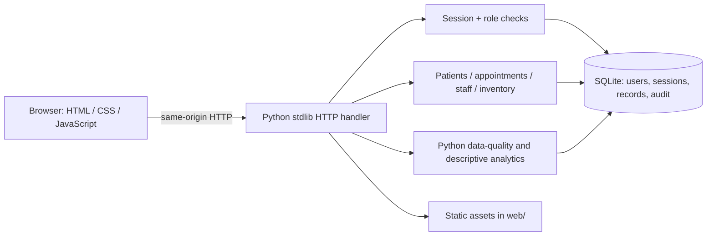

# Architecture

## Verified local version

The small deployment keeps UI, REST endpoints, and database local on one process/machine, appropriate for a low-memory laptop and fictional demo. API routes validate inputs and delegate SQL to parameterized statements. Database constraints provide a second validation layer. All state changes and their audit record share a SQLite transaction.

## Requested target architecture vs current build

The requested Angular + TypeScript frontend, Express + Node backend, Python processing service, and PostgreSQL production database are not implemented in this verified build. npm registry access is unavailable, Angular CLI/compiler are absent, and a local PostgreSQL server is not running. Rather than leave an unbuildable skeleton, this first iteration uses standard-library Python and a browser-native frontend. `docs/openapi.yaml` defines a transport contract to guide a later modular migration. No claim of Angular, Express, or PostgreSQL testing is made.

A future production-grade modular architecture could place Angular and Express in separate apps and use PostgreSQL for shared persistence, with the Python quality module called as a bounded worker/library. Before that migration, define deployment, identity lifecycle, retention, migrations, backups, observability, and a tested public-demo read-only profile.
