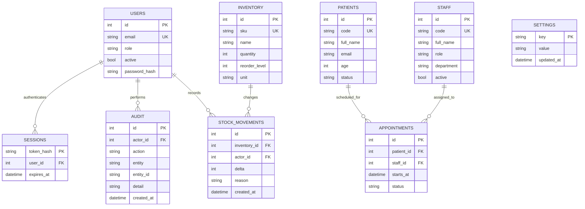

# Data model

All example records are synthetic. SQLite constraints reject negative stock, impossible ages, duplicate codes/emails, unsupported states, and dangling relationships.

Sessions store SHA-256 token digests rather than bearer tokens. Passwords use a random 16-byte salt and PBKDF2-HMAC-SHA256 (240,000 rounds). Audit detail avoids patient name/email fields. The schema does not contain real medical-record, diagnosis, medication, or treatment data.
